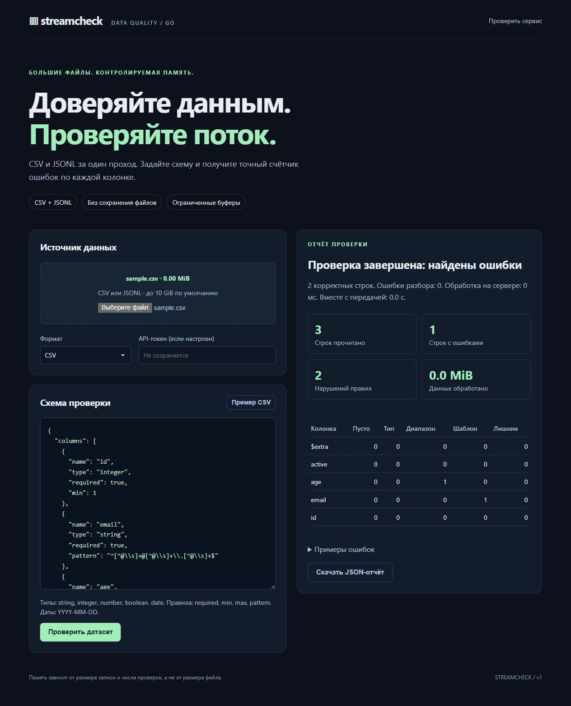

# Streamcheck

[](https://render.com/deploy?repo=https://github.com/nail-rinatovich/streamcheck)
[](https://github.com/nail-rinatovich/streamcheck/actions/workflows/ci.yml)

Пет-проект на Go: потоковый валидатор CSV и JSONL с веб-интерфейсом, HTTP API и CLI. Проверяет схему и считает ошибки по колонкам за один проход. Без внешних Go-зависимостей, базы данных и временного сохранения загрузок на сервере.



## Сначала — файл больше доступной памяти

Основной эксперимент: реальный файл **256 MiB** читается процессом с **жёстким лимитом памяти 64 MiB** через Windows Job Object. Ограничение устанавливается до запуска кода валидатора; `GOMEMLIMIT=24MiB` задаёт отдельную мягкую цель GC. Это тест доступной памяти процесса; файл не превышал все 16 GiB физической RAM компьютера.

Измерено локально 22 ноября 2026 года, Windows amd64, Go 1.26.4:

| Формат | Размер файла | Жёсткий лимит | Пик committed memory процесса | Строк | Ошибочных строк | Время CLI |
| --- | ---: | ---: | ---: | ---: | ---: | ---: |
| CSV | 268 436 418 байт | 64 MiB | 51.96 MiB | 256 386 | 256 | 4.65 с |
| JSONL | 268 436 026 байт | 64 MiB | 51.88 MiB | 248 782 | 248 | 5.97 с |

Оба файла прочитаны до EOF; счётчики совпали с генератором: в каждой тысячной строке намеренно неверный возраст. Это результат для записей примерно по 1 KiB и данной схемы, а не обещание расхода памяти для любых входных данных. Исходные JSON-измерения и отчёты находятся в `reports/memory-*`.

Повторить в PowerShell из корня проекта:

```powershell
go build -o bin/streamcheck.exe ./cmd/streamcheck
go build -o bin/datagen.exe ./cmd/datagen
python scripts/memory-check-windows.py --format csv
python scripts/memory-check-windows.py --format jsonl
```

Сценарий создаёт файлы в `tmp/`. Можно увеличить эксперимент: `--file-mib 1024 --limit-mib 64`. На Linux/macOS с запущенным Docker:

```sh
sh scripts/memory-check-docker.sh
```

Контейнер получает `--memory=64m --memory-swap=64m`, а входной файл — 256 MiB. Этот сценарий включён в GitHub Actions. Локально Docker-проверка не выполнялась: Docker Engine был недоступен; жёсткий лимит проверен средствами Windows.

## Быстрый запуск

Нужен Go 1.26 или новее.

```sh
go run ./cmd/streamcheck serve
```

Открыть **http://localhost:10000**. Выбрать `examples/sample.csv` или `examples/sample.jsonl`, оставить предложенную схему, нажать «Проверить датасет». В обоих примерах 3 строки: 2 корректные и 1 с двумя нарушениями. Отчёт можно скачать в JSON. Кнопка «Пример CSV» скачивает небольшой тестовый файл.

CLI для файлов на диске и потоков:

```sh
go run ./cmd/streamcheck validate --schema examples/schema.json --input examples/sample.csv --format csv
go run ./cmd/streamcheck validate --schema examples/schema.json --input examples/sample.jsonl --format jsonl
```

Результат — JSON в stdout; сведения о Go heap и ошибка незавершённой проверки — в stderr. При запуске собранного бинарника коды возврата: `0` — завершено, нарушений нет; `2` — завершено, найдены нарушения; `1` — неверные параметры или незавершённое чтение. `go run` оборачивает код дочернего процесса, поэтому автоматизацию нужно запускать через бинарник. `--input -` читает stdin. `--samples 0` отключает примеры ошибок.

## Схема

Это собственный компактный формат схемы, не стандарт JSON Schema.

```json
{
  "columns": [
    {"name": "id", "type": "integer", "required": true, "min": 1},
    {"name": "email", "type": "string", "required": true, "pattern": "^[^@\\s]+@[^@\\s]+\\.[^@\\s]+$"},
    {"name": "age", "type": "integer", "min": 0, "max": 120},
    {"name": "active", "type": "boolean", "required": true}
  ],
  "allow_extra": false
}
```

| Тип / правило | Поведение |
| --- | --- |
| `string` | В JSONL требуется JSON-строка; в CSV — текст ячейки |
| `integer` | Целое в диапазоне int64; `1.0`, `1e2` и JSON-строка `"1"` не подходят |
| `number` | Конечный float64; NaN и Infinity отклоняются |
| `boolean` | CSV: строго `true` / `false`; JSONL: JSON boolean |
| `date` | Строка с реальной календарной датой `YYYY-MM-DD` |
| `required` | Отсутствие или null — ошибка; пустая CSV-ячейка тоже считается отсутствием. Пустая JSON-строка допустима: запретить её можно `pattern: ".+"` |
| `min`, `max` | Включительные числовые границы; сравнение через float64 |
| `pattern` | Регулярное выражение Go RE2, только для string. Для полного совпадения используйте `^...$` |
| `allow_extra` | При false каждый неизвестный ключ/столбец увеличивает счётчик `$extra.extra` |

Тип `integer` сохраняет int64-точность при разборе JSON. Числовые границы представлены float64: для точных границ выше 2^53 потребуется расширить формат схемы. Имена колонок уникальны, не начинаются с `$`, до 128 байт; схема содержит 1–128 колонок и занимает не более 32 KiB.

CSV: разделитель — запятая, первая запись — заголовок. Поддерживаются UTF-8 BOM, CRLF, кавычки, экранирование `""` и переносы строк внутри кавычек. Дубли/пустые имена и отсутствие обязательной колонки в заголовке останавливают проверку. Несовпадение числа ячеек даёт ошибку записи и позволяет продолжить. Неверный синтаксис кавычек останавливает проверку: безопасно восстановить границы следующей записи нельзя. Пустая CSV-запись считается ошибкой, не пропускается.

JSONL: один объект на физическую строку. Повреждённый JSON, пустая строка, массив вместо объекта, повторный ключ верхнего уровня и лишний JSON после объекта дают `parse_errors`; чтение продолжается со следующей строки. Последняя строка без перевода строки поддерживается. Вложенные структуры не проверяются по пути; для заданных скалярных типов считаются ошибкой типа. Повторные ключи вложенных объектов отдельно не диагностируются.

`rows` — число прочитанных записей данных, без CSV-заголовка. Номера в примерах — номера записей, а не физических строк. `errors` считает нарушения: одна строка может нарушить несколько правил. `parse_errors` входит в `errors`, но не относится к определённой колонке. Отсутствующее необязательное поле не даёт ошибку. Для завершённого отчёта `valid_rows + invalid_rows == rows`. При `complete: false` отчёт частичный и не подтверждает качество всего файла.

## Потоковая архитектура

```text
Файл / HTTP body
    → буфер 32 KiB
    → ограниченная запись CSV / строка JSONL
    → разбор и проверка схемы
    → счётчики + не более 20 примеров
    → JSON-отчёт
```

Сервер не вызывает `ParseMultipartForm`, не сохраняет загрузку и не накапливает строки. Читает raw request body. Ограничение размера записи проверяется до добавления нового фрагмента в буфер. Нет `ReadAll` для датасета; небольшая схема читается с отдельным лимитом.

Память: **O(concurrency × max_record_bytes + schema + samples)** с коэффициентами на буферы, JSON-декодирование, карты значений и Go runtime. По умолчанию запись — максимум 1 MiB, параллельно — максимум 2 проверки. Слишком большая запись останавливает проверку. В отчёте максимум 20 примеров без значений ячеек; динамические имена неизвестных колонок не накапливаются. `GOMEMLIMIT` — мягкая цель GC, не жёсткий предел RSS.

Браузер передаёт File напрямую в fetch; гарантия ограниченных буферов относится к серверу и CLI. Использование памяти и буферизация самим браузером не измерялись. Процент готовности не показывается: итог выдаётся после EOF.

## HTTP API

```sh
curl -X POST 'http://localhost:10000/api/validate?format=csv' \
  -H 'Content-Type: application/octet-stream' \
  -H "X-Schema: $(cat examples/schema.json)" \
  --data-binary @examples/sample.csv
```

PowerShell:

```powershell
$schema = Get-Content examples/schema.json -Raw | ConvertFrom-Json | ConvertTo-Json -Depth 10 -Compress
Invoke-RestMethod -Method Post -Uri 'http://localhost:10000/api/validate?format=csv' `
  -Headers @{ 'X-Schema' = $schema } -ContentType 'application/octet-stream' `
  -InFile examples/sample.csv
```

Схема в `X-Schema` должна быть в одну строку. Не-ASCII символы передавайте JSON escape-последовательностями `\uXXXX`: UI делает это автоматически. Запросы с настроенным `API_TOKEN` требуют `Authorization: Bearer <token>`; UI предлагает поле токена и не сохраняет его в localStorage.

| Endpoint / статус | Значение |
| --- | --- |
| `GET /` | Веб-интерфейс, встроенный в Go-бинарник |
| `POST /api/validate?format=csv\|jsonl` | Raw файл в теле, схема в `X-Schema` |
| `GET /healthz` | Независимая проверка работоспособности |
| `GET /metrics` | Счётчики в текстовом формате Prometheus |
| `200` | Датасет прочитан полностью; нарушения описаны в отчёте |
| `400` / `401` | Неверный формат/схема / токен |
| `408` | Истёк срок обработки/чтения |
| `413` | Превышен общий лимит тела |
| `422` | Незавершённое чтение, некорректный CSV или слишком большая запись; частичный отчёт в `report` |
| `429` | Все слоты заняты, `Retry-After: 2` |

Различайте успешный HTTP-ответ и корректность данных: наличие ошибок схемы не превращает завершённую проверку в HTTP 500. Метрики считают допущенные проверки, отказы 429, незавершённые проверки, обработанные строки/байты и активные проверки. Нет пользовательских label и содержимого файлов. Счётчики живут в памяти одной инстанции и сбрасываются при перезапуске.

## Проверка нагрузки через hey

Да: `hey` подходит для нагрузки на raw POST endpoint. Он считывает `-D` в память на стороне **генератора нагрузки**, поэтому для файла, превышающего RAM, используйте CLI/`curl`, а для `hey` — много небольших/средних файлов. Измерение GET `/healthz` не заменяет проверку валидатора.

Установка фиксированной версии:

```sh
go install github.com/rakyll/hey@v0.1.4
```

Запустить сервис в одном терминале, в другом:

```powershell
# hey должен быть в PATH; либо передайте -Hey полный/относительный путь к hey.exe.
./scripts/load-test.ps1 -Duration 30s
# После деплоя:
./scripts/load-test.ps1 -BaseUrl https://YOUR-SERVICE.onrender.com -Duration 30s
```

Linux/macOS:

```sh
DURATION=30s sh scripts/load-test.sh
BASE_URL=https://YOUR-SERVICE.onrender.com DURATION=30s sh scripts/load-test.sh
FORMAT=jsonl DURATION=30s sh scripts/load-test.sh
```

Если включена авторизация, задайте `API_TOKEN` в окружении генератора. Скрипты создают валидный файл около 1 MiB, проверяют health, выполняют этапы с `-c 1`, `-c 2`, `-c 8`, сохраняют stdout `hey` и итоговые метрики в `reports/`. На этапе 8 клиентов `-q 25` ограничивает каждый worker: максимум 200 запросов/с. Сначала прогревайте инстанцию; холодный старт Render измеряйте отдельно.

Фактический локальный smoke-прогон CSV, 5 секунд на этап, файл 1 049 114 байт, `MAX_CONCURRENT=2`:

| Клиентов | HTTP 200 | HTTP 429 | Всего RPS | p95 всех ответов |
| ---: | ---: | ---: | ---: | ---: |
| 1 | 258 | 0 | 51.38 | 26.1 мс |
| 2 | 272 | 0 | 53.21 | 76.5 мс |
| 8 | 125 | 678 | 158.52 | 100.5 мс |

`5xx` и транспортных ошибок в этом прогоне нет. Сырые результаты: `reports/hey-csv-c*.txt`. Это короткий локальный эксперимент при общей нагрузке на Windows, не результат Render и не production capacity. Высокий общий RPS с 429 **не** означает рост полезной пропускной способности: на третьем этапе успешно около 24.68 проверок/с. p95 третьего этапа смешивает 200 и 429; для p95 только успешных запросов нужен генератор с группировкой по статусам. В детальном блоке `hey` на Windows наблюдалось некорректное `resp wait` при раннем отказе во время передачи тела; для вывода использованы итоговая длительность, общие latency и счётчики статусов.

Смотрите latency p50/p95/p99, успешные проверки/с, MB/s, долю 429, время CPU и память на Render. Генератор лучше запускать с другой машины. `hey` здесь — внешний инструмент для разработчика, не публичная кнопка запуска нагрузки на произвольный URL.

## Публикация на Render

Репозиторий: [nail-rinatovich/streamcheck](https://github.com/nail-rinatovich/streamcheck). Конфигурация для Render уже находится в корне. Публикацию сервиса выполняет владелец своего аккаунта Render.

1. Нажать **Deploy to Render** в начале README и войти в аккаунт Render.
2. Проверить предложенный Free Web Service и подтвердить создание. Render прочитает `render.yaml`, соберёт Dockerfile и запустит приложение. Альтернатива: **New → Blueprint**, подключить этот репозиторий и применить `render.yaml`.
3. Дождаться сборки; открыть выданный `https://...onrender.com`, проверить UI и `/healthz`.
4. При необходимости добавить `API_TOKEN` как secret в Environment, затем повторить запрос и сценарий `hey` по выданному URL.

Если выбрать **New → Web Service** вручную: репозиторий `https://github.com/nail-rinatovich/streamcheck`, ветка `main`, runtime **Docker**, путь к Dockerfile `./Dockerfile`, health check `/healthz`, тариф **Free**. Build Command и Start Command задавать не нужно: сборку и запуск описывает Dockerfile. Автоматический деплой при каждом push отключён в Blueprint; обновления можно запускать вручную в Render.

Dockerfile: многоэтапная сборка, статический Go-бинарник, `scratch`, пользователь 65532. Приложение слушает `0.0.0.0:$PORT`, штатно обрабатывает SIGTERM и завершает активные запросы в течение 15 секунд. Локально Linux-бинарник проверяется кросс-компиляцией; сборку контейнера выполняет CI.

| Переменная | По умолчанию | Назначение |
| --- | --- | --- |
| `PORT` | `10000` | Порт HTTP, на Render предоставляется платформой |
| `MAX_UPLOAD_BYTES` | `10737418240` | Лимит файла 10 GiB, не обещание лимита прокси Render |
| `MAX_RECORD_BYTES` | `1048576` | Максимум одной записи, допускается до 16 MiB |
| `MAX_CONCURRENT` | `2` | Число одновременно принятых проверок, допустимо 1–64 |
| `REQUEST_TIMEOUT` | `10m` | Дедлайн чтения тела и обработки |
| `GOMEMLIMIT` | `192MiB` в Blueprint | Мягкая цель памяти Go runtime |
| `API_TOKEN` | пусто | Необязательный Bearer-токен для POST |

Free-инстанции Render засыпают после 15 минут без входящего трафика; холодный старт влияет на первый запрос. Время/размер загрузки могут быть ограничены прокси, сетью и планом раньше лимитов приложения. Многогигабайтные проверки надёжнее запускать через CLI рядом с файлом. В этой версии HTTP-проверка синхронная: нет очереди, resumable upload, фоновых jobs и продолжения после перезапуска. Для следующей версии: объектное хранилище + очередь + worker с сохранением прогресса.

Файлы и их значения не логируются и не сохраняются сервером; отчёт возвращается клиенту. API без `API_TOKEN` публичен, с ограниченной параллельностью. В проекте нет отправки сообщений, внешних вызовов или скачивания файла по пользовательскому URL.

Официальные источники: [Render Web Services](https://render.com/docs/web-services), [Blueprint YAML](https://render.com/docs/blueprint-spec), [Free instances](https://render.com/docs/free), [hey: параметры и исходники](https://github.com/rakyll/hey).

## Проверки и структура

```sh
go test ./...
go vet ./...
go test -race ./... # требует CGO и C compiler; выполняется в Linux CI
go test ./internal/validator -bench . -benchmem
```

Тесты проверяют счётчики и sample cap, точность int64, строгие типы JSON, дубли ключей, продолжение после битой JSONL-строки, multiline CSV через границу буфера, BOM/CRLF, лимит записи, ошибки читателя, отмену контекста, HTTP 413/422, авторизацию, 429 при занятости и освобождение слота после дедлайна. Локальная race-проверка не запускалась: нет C compiler; GitHub Actions настроен на `go test -race`.

```text
cmd/streamcheck/       CLI и запуск сервера
cmd/datagen/           Детерминированный генератор больших файлов
internal/validator/   Схема, потоковый разбор и проверки
internal/server/      HTTP, лимиты, метрики, встроенный UI
examples/             Схема и небольшие датасеты
scripts/              Hard-memory эксперименты и нагрузка hey
reports/              Полученные локальные измерения и скриншот
Dockerfile            Контейнер для Render
render.yaml           Render Blueprint
.github/workflows/    Тесты, race, сборка и memory-check в CI
```

Лицензия MIT. Возможное развитие для портфолио: async jobs, сравнение схем, пользовательские правила, Prometheus/Grafana и нагрузочные тесты с проверкой содержимого отчётов.
